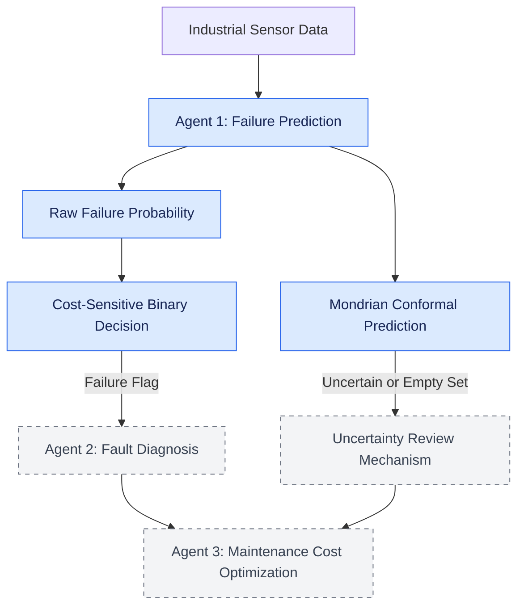

# Agent 1 — Predictive Maintenance Failure Detection

**Binary Failure Prediction, Uncertainty Quantification and Cost-Sensitive Decision Support**

## 1. Project Overview

Agent 1 is a machine-learning component developed as part of a Mechanical Engineering diploma thesis on **AI Agents for Predictive Maintenance and Cost Optimization**.

The objective is to estimate the probability of industrial machine failure using operational sensor measurements, quantify predictive uncertainty, and support downstream maintenance decisions.

The framework combines:

- Pipeline-based preprocessing and feature engineering.
- Group-aware machine learning validation.
- XGBoost-based binary failure prediction.
- Probability reliability assessment.
- Cost-sensitive threshold optimization.
- Class-conditional Mondrian conformal prediction.
- Standalone deployment and automated regression testing.

Agent 1 predicts whether a machine is likely to fail. It does not diagnose the specific failure type or determine the final maintenance action.

---

## 2. Multi-Agent Architecture

The proposed multi-agent framework separates failure prediction, fault diagnosis, and maintenance decision-making into three distinct components.



| Component | Responsibility | Status |
| --- | --- | --- |
| Agent 1 | Binary failure prediction and uncertainty quantification | Implemented |
| Agent 2 | Multi-label fault diagnosis | Planned |
| Agent 3 | Maintenance decision-making and cost optimization | Planned |
| Review Mechanism | Management of uncertain predictions | Planned |

The architecture illustrates the proposed integration of the agents. Only Agent 1 is implemented in the current repository.

---

## 3. Dataset

The project uses the AI4I-PMDI predictive maintenance dataset.

The binary classification task distinguishes between healthy operating conditions and machine failure.

### Input Features

| Feature | Description | Unit |
| --- | --- | --- |
| Type | Machine type (L, M, H) | Categorical |
| Air_temperature_K | Air temperature | K |
| Process_temperature_K | Process temperature | K |
| Rotational_speed_rpm | Rotational speed | rpm |
| Torque_Nm | Applied torque | Nm |
| Tool_wear_min | Tool wear | min |

Machine identifiers are used for group-aware data splitting to prevent observations from the same system from appearing in incompatible training and validation subsets.

Random failures are excluded from the supervised training task and investigated separately through a development-only stress test.

### Data Preprocessing

The preprocessing pipeline includes:

- Machine type encoding.
- Temperature missingness indicators.
- Median imputation.
- Temperature difference feature engineering.
- Group-aware data partitioning.

The engineered temperature difference feature is defined as:

**Temp_diff_K = Process_temperature_K − Air_temperature_K**

Learned preprocessing operations are fitted within the corresponding training subsets to reduce the risk of data leakage.

---

## 4. Methodology

### 4.1 Group-Aware Data Splitting

The dataset is partitioned into development and test subsets using machine-level group separation.

The final development pipeline uses three mutually group-disjoint subsets:

1. Model training and hyperparameter optimization.
2. Cost-sensitive threshold selection.
3. Mondrian conformal calibration.

This separation prevents the same machine groups from being reused across these three final fitting stages.

### 4.2 Model Development

The experimental framework investigates:

- Baseline machine learning classifiers.
- Class imbalance handling strategies.
- Plain and weighted XGBoost.
- Nested group-aware cross-validation.
- Hyperparameter optimization.
- Repeated development-only model comparisons.

The final deployed classifier is a Plain XGBoost model with `scale_pos_weight = 1.0`.

### 4.3 Probability Reliability Assessment

Three probability estimation approaches are investigated:

- Raw XGBoost probabilities.
- Sigmoid calibration.
- Isotonic calibration.

Probability reliability is assessed using:

- Brier Score.
- Expected Calibration Error (ECE).
- Reliability diagrams.

Raw XGBoost probabilities are selected for the final deployment pipeline based on the development experiments.

No external probability calibration is applied to the deployed model.

### 4.4 Cost-Sensitive Decision Optimization

The binary decision threshold is selected by minimizing empirical misclassification cost over the evaluated threshold candidates.

The cost function is defined as:

**C(t) = C<sub>FN</sub> × FN(t) + C<sub>FP</sub> × FP(t)**

where:

- C<sub>FN</sub> is the false-negative cost.
- C<sub>FP</sub> is the false-positive cost.
- FN(t) is the number of false negatives.
- FP(t) is the number of false positives.

The assumed cost ratio is:

**C<sub>FN</sub> : C<sub>FP</sub> = 10 : 1**

Threshold selection is performed exclusively on a dedicated development subset.

### 4.5 Mondrian Conformal Prediction

Class-conditional Mondrian conformal prediction is used to quantify predictive uncertainty.

The nonconformity score is defined as:

**s(x,y) = 1 − p̂(y | x)**

Class-specific conformal quantiles are estimated from a separate development calibration subset.

The resulting prediction set may contain:

- Only `NO FAILURE`.
- Only `FAILURE`.
- Both class labels.
- No class labels.

The nominal conformal coverage level is 90%, corresponding to:

**α = 0.10**

Formal coverage guarantees depend on the relevant exchangeability assumptions.

The development notebook is organized into 16 parts, covering the complete workflow from data preparation to standalone deployment.

The development notebook covers:

1. Data preparation, feature engineering, pipeline construction and group-disjoint data splitting (1, 2, 3).
2. Class imbalance handling, baseline model comparison and hyperparameter optimization (4, 5, 6).
3. Probability calibration comparison and reliability assessment (7).
4. Cost-sensitive decision analysis, final threshold selection and statistical uncertainty estimation (8, 10).
5. Mondrian conformal prediction, uncertainty quantification and final model fitting (9).
6. Development-only evaluation, scientific visualizations and random failure stress testing (11, 13).
7. Model serialization, standalone inference, automated regression testing, deployment consistency and package export (12, 14, 15, 16).

The final deployed model combines pipeline-based preprocessing, temperature difference feature engineering, Plain XGBoost classification, raw probability estimation, Mondrian conformal prediction and cost-sensitive decision-making.

The notebook documents the complete experimental methodology and development results, while the standalone package provides a reusable inference interface with automated regression testing.


---

## 5. Final Model Configuration

| Parameter | Selected Configuration |
| --- | --- |
| Classifier | XGBoost |
| Class imbalance strategy | Plain XGBoost |
| scale_pos_weight | 1.0 |
| Learning rate | 0.05 |
| Maximum tree depth | 5 |
| Number of estimators | 200 |
| External probability calibration | None |
| Probability estimation | Raw XGBoost |
| Conformal method | Raw Mondrian |
| Conformal alpha | 0.10 |
| Nominal conformal coverage | 90% |
| Cost ratio (FN:FP) | 10:1 |
| Selected decision threshold | 0.08 |
| Validation status | Development only |

The model, preprocessing pipeline, decision threshold, and conformal quantiles are stored together in the serialized deployment package.

---

## 6. Repository Structure

```text
Agent_1/
│
├── pipeline_Agent1.ipynb
│
├── Agent_1_pack/
│   ├── agent1_components.py
│   ├── agent1_raw_mondrian_development.pkl
│   ├── predict.py
│   ├── test_agent1.py
│   ├── reference_cases.json
│   ├── requirements.txt
│   └── README.md
│
├── Data/
├── response_to_supervisor.md
└── README.md
```

| Path | Description |
| --- | --- |
| [pipeline_Agent1.ipynb](pipeline_Agent1.ipynb) | Model development, experimental methodology, evaluation and deployment generation |
| [Agent_1_pack/](Agent_1_pack/) | Standalone Agent 1 inference package |
| [Data/](Data/) | Project dataset |
| [response_to_supervisor.md](response_to_supervisor.md) | Documentation of supervisor feedback, methodological revisions and implementation changes |
| [Agent_1_pack/README.md](Agent_1_pack/README.md) | Detailed deployment and usage documentation |

The standalone deployment package contains seven files and does not require access to the original notebook or training dataset for inference.

---

## 7. Installation and Usage

For detailed installation instructions, dependency requirements, automated regression testing, and prediction examples, refer to the [Agent 1 Deployment Documentation](Agent_1_pack/README.md).

The standalone package supports inference without executing the development notebook.

---

## 8. Prediction Output

The public inference function `predict_failure(machine_data)` returns seven output fields.

| Output Field | Description |
| --- | --- |
| failure_probability | Raw XGBoost failure probability |
| prediction | Cost-sensitive binary decision |
| threshold | Saved decision threshold |
| prediction_set | Mondrian conformal prediction set |
| uncertainty_status | Interpretation of the conformal prediction set |
| send_to_agent2 | Boolean routing flag for Agent 2 |
| conformal_alpha | Conformal significance level |

### 8.1 Binary Decision

The binary decision is determined by:

| Condition | Binary Label | Decision |
| --- | --- | --- |
| p̂ ≥ t* | 1 | FAILURE |
| p̂ &lt; t* | 0 | NO FAILURE |

where:

- **p̂** is the predicted failure probability.
- **t\*** is the saved cost-sensitive decision threshold.

The selected decision threshold is **t\* = 0.08**.

### 8.2 Uncertainty Interpretation

| Prediction Set | Uncertainty Status |
| --- | --- |
| {NO FAILURE} | HEALTHY |
| {FAILURE} | FAILURE |
| {NO FAILURE, FAILURE} | UNCERTAIN |
| Empty set | REVIEW_REQUIRED |

The cost-sensitive binary decision and the conformal prediction set represent separate outputs.

A failure may be flagged by the cost-sensitive threshold even when the conformal prediction set is empty or ambiguous.

### 8.3 Agent Routing Policy

The `send_to_agent2` routing flag is set to `True` exclusively when the predicted failure probability reaches or exceeds the saved decision threshold.

Actual Agent 2 execution requires integration at the multi-agent orchestration level.

Conformal uncertainty does not directly activate Agent 2.

Cases marked as `REVIEW_REQUIRED` or `UNCERTAIN` must be handled by a separate review mechanism at the multi-agent orchestration level, regardless of the binary decision.

The external review mechanism is not implemented within Agent 1.

---

## 9. Deployment Verification

The standalone Agent 1 package has been verified through:

- Automated regression testing using 100 fixed reference cases.
- Verification of all seven inference output fields.
- Probability comparison with an absolute tolerance of 1e-6.
- Intentional threshold corruption and successful error detection.
- Successful model restoration and regression retesting.
- Notebook-to-deployment prediction consistency.
- Missing-value handling and input validation.
- Standalone execution in a separate Google Colab notebook.

The reference cases originate from the test partition and are used for software regression testing after the model, threshold, and conformal quantiles are fixed.

These tests verify software consistency rather than independent predictive performance.

Detailed testing procedures are available in the [deployment documentation](Agent_1_pack/README.md).

---

## 10. Scientific Results

All results presented in this section are derived from development experiments. They do not represent independent final test performance.

### 10.1 Model Selection

Plain and Weighted XGBoost were compared through five repeated group-aware development experiments using calibrated probabilities.

| Metric | Plain XGBoost | Weighted XGBoost |
| --- | ---: | ---: |
| Mean Recall | 0.9480 | 0.9513 |
| Mean Precision | 0.5460 | 0.5087 |
| Mean Cost per 1,000 observations | 48.9377 | 53.0779 |
| Cost Standard Deviation | 12.1835 | 10.4588 |
| Mean Brier Score | 0.0086 | 0.0086 |

Plain XGBoost achieved lower empirical cost in four out of five repetitions, with approximately 7.8% lower mean cost than Weighted XGBoost.

Based on these development results, Plain XGBoost was selected for the final implementation.

The comparison does not establish statistically significant superiority.

**Notebook reference:** Section 4.7.

### 10.2 Predictive Performance

The following metrics were calculated on the dedicated development threshold-selection subset using the final Raw XGBoost model.

| Metric | Estimate | 95% CI Lower | 95% CI Upper |
| --- | ---: | ---: | ---: |
| Precision | 0.5966 | 0.4444 | 0.7255 |
| Recall | 0.9726 | 0.9206 | 1.0000 |
| F1-score | 0.7396 | 0.6052 | 0.8345 |
| ROC-AUC | 0.9959 | 0.9925 | 0.9982 |
| Average Precision | 0.9315 | 0.8563 | 0.9713 |

Descriptive 95% confidence intervals were estimated through 2,000 cluster bootstrap resamples across 24 machine systems.

The decision threshold remained fixed at 0.08 during bootstrap resampling.

Since threshold selection and metric estimation use the same subset, these results do not constitute independent performance estimates.

**Notebook reference:** Sections 10.1 and 10.2.

### 10.3 Probability Reliability

Three probability estimation methods were compared using nested group-aware development predictions.

| Method | Brier Score | ECE |
| --- | ---: | ---: |
| Raw XGBoost | 0.0074 | 0.0035 |
| Sigmoid | 0.0077 | 0.0033 |
| Isotonic | 0.0077 | 0.0025 |

Raw XGBoost achieved the lowest Brier Score, while Isotonic calibration achieved the lowest ECE.

The selection procedure prioritizes Brier Score, followed by ECE.

Consequently, raw probabilities were selected for the final deployment pipeline.

**Notebook reference:** Section 7.2.

### 10.4 Cost Optimization

The final decision threshold was selected on a dedicated group-disjoint development subset.

| Parameter | Value |
| --- | ---: |
| False-negative cost | 10 |
| False-positive cost | 1 |
| Selected threshold | 0.08 |
| True Positives | 71 |
| True Negatives | 1917 |
| False Positives | 48 |
| False Negatives | 2 |
| Total empirical cost | 68 |

The selected threshold minimizes empirical misclassification cost among the evaluated threshold candidates.

The resulting cost is:

**C = 10 × 2 + 1 × 48 = 68**

These results describe the threshold-selection subset and should not be interpreted as independent test performance.

**Notebook reference:** Section 10.1.

### 10.5 Conformal Uncertainty

Three Mondrian conformal approaches were compared across five repeated group-disjoint development splits.

The nominal coverage level was 90% (α = 0.10).

| Metric | Raw | Randomized | Sigmoid |
| --- | ---: | ---: | ---: |
| Mean Overall Coverage | 90.27% | 90.12% | 90.32% |
| Mean Class 0 Coverage | 90.25% | 90.13% | 90.31% |
| Mean Class 1 Coverage | 90.24% | 88.90% | 90.00% |
| Mean Prediction Set Size | 0.9178 | 0.9146 | 0.9183 |
| Mean Empty Set Rate | 8.22% | 8.54% | 8.17% |
| Mean Ambiguous Set Rate | 0.00% | 0.00% | 0.00% |

Raw Mondrian was selected for the final implementation based on the development comparison.

The selected method achieved mean coverage close to the nominal target for both classes.

However, empty prediction sets occurred in approximately 8.22% of observations across the repeated development experiments, highlighting the need for an explicit uncertainty-handling policy.

These results describe the repeated conformal method comparison, not independent coverage of the final deployed model.

The notebook also includes exploratory conformal coverage diagnostics that should not be interpreted as independent coverage validation.

**Notebook reference:** Section 9.3C.

### 10.6 Random Failure Stress Test

Random failures were excluded from supervised model training and evaluated separately using observations from development systems.

| Metric | Result |
| --- | ---: |
| Random Failure Observations | 12 |
| Detected Random Failures | 1 |
| Detection Rate | 8.33% |
| Uncertainty Rate | 8.33% |

The results indicate limited detection capability for random failures.

The small sample size limits the interpretation and generalizability of these findings.

**Notebook reference:** Section 13.2.

---

## 11. Scientific Limitations

- The current model is evaluated at the development stage and is not validated for production deployment.
- The test partition was previously accessed during development and is not a pristine independent final holdout.
- Exploratory data analysis includes full-dataset descriptive visualizations. Final model fitting, threshold selection and conformal calibration are restricted to development data.
- No external probability calibration is applied to the deployed model.
- Group-disjoint splitting alone does not establish a formal conformal coverage guarantee for unseen machines.
- The selected threshold minimizes empirical cost among the evaluated candidates, under an assumed cost ratio.
- Random failure detection remains limited.
- Physical operating limits and out-of-distribution detection are not explicitly implemented.
- The external uncertainty review mechanism remains to be implemented.

**Current validation status: DEVELOPMENT ONLY.**

Further methodological and deployment limitations are documented in the [deployment README](Agent_1_pack/README.md).

---

## 12. Future Work

The next stages of the research include:

- Development of Agent 2 for multi-label fault diagnosis.
- Development of Agent 3 for maintenance decision-making and cost optimization.
- Integration of the three agents into a unified predictive maintenance framework.
- Implementation of an uncertainty-aware review mechanism.
- Evaluation using a previously unseen independent dataset.
- Investigation of robustness under distribution shift.
- Validation using realistic industrial maintenance costs.

---

## 13. Academic Context

**Research Project:** AI Agents for Predictive Maintenance and Cost Optimization

**Department:** Mechanical Engineering and Aeronautics

**Institution:** University of Patras, Greece

**Project Type:** Diploma Thesis

**Research Areas:**

- Artificial Intelligence
- Predictive Maintenance
- Industrial Machine Learning
- Uncertainty Quantification
- Conformal Prediction
- Cost Optimization
- Multi-Agent Systems

This repository represents an ongoing academic research project.
